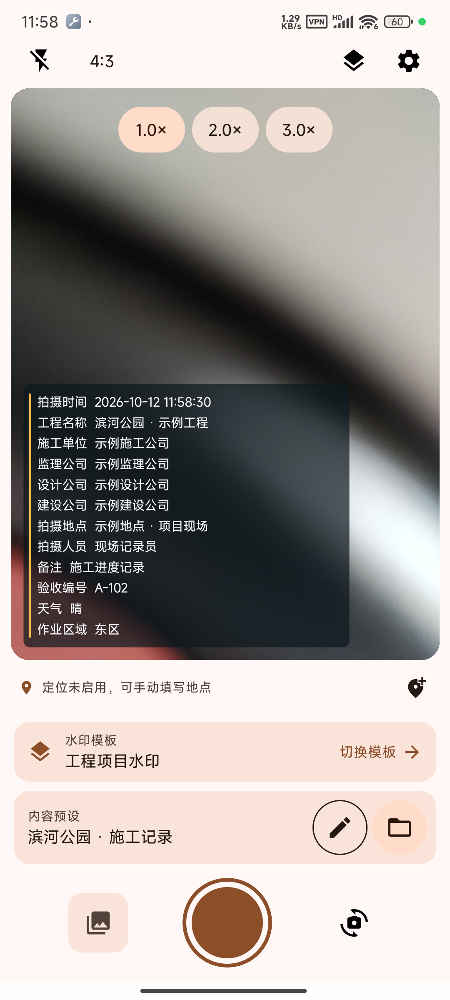
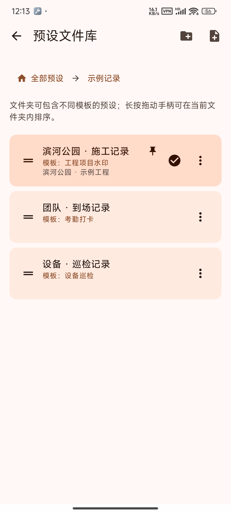
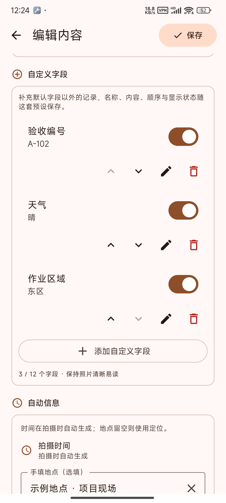
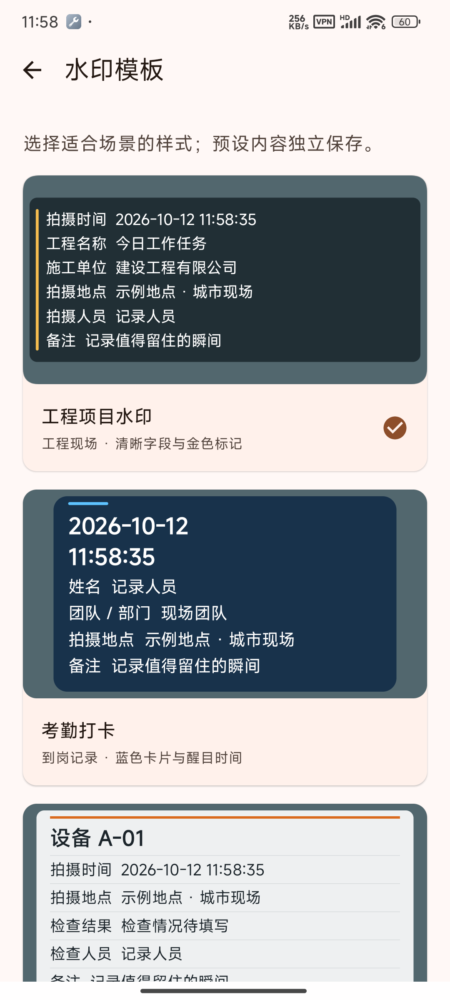
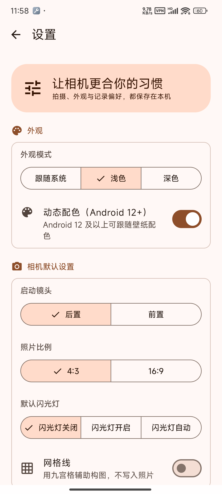
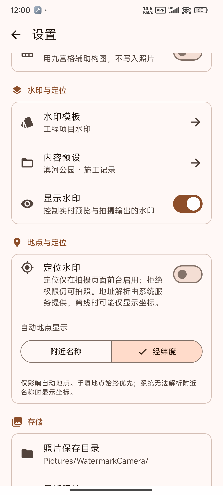

**拍下来，也记下来。**

给照片加上时间、地点与你的记录。
工程现场、工作进度，或旅途中的一刻，都能用一张照片说明白。

[**下载 Android 安装包**](https://github.com/kindyear/KWatermarkCam/releases) · [查看更新](https://github.com/kindyear/KWatermarkCam/releases/tag/v0.3.1) · [反馈问题](https://github.com/kindyear/KWatermarkCam/issues)

Android 10 及以上 · 免费使用 · 无需账号

## 看看实际界面

下面来自 **Redmi K40 真机**，内容为示例项目。截图拍摄于 0.3.0 开发期间，展示实际应用界面。

<table>
  <tr>
    <td align="center" width="33%"><b>实时水印 · 拍前就能看到</b>  </td>
    <td align="center" width="33%"><b>内容预设 · 像文件一样整理</b>  </td>
    <td align="center" width="33%"><b>自定义字段 · 记录你需要的</b>  </td>
  </tr>
</table>

<b>再看看模板和拍摄偏好</b>

 
<table>
  <tr>
    <td align="center" width="33%"><b>选择水印样式</b>  </td>
    <td align="center" width="33%"><b>设置你的拍摄习惯</b>  </td>
    <td align="center" width="33%"><b>地点显示，由你选择</b>  </td>
  </tr>
</table>

## 一张照片，带上完整记录

| 拍得方便 | 记得清楚 |
| :--- | :--- |
| 前后镜头切换、点击对焦、双指缩放 | 拍摄时自动加入时间，自动地点可选附近名称或经纬度，也能手填地点 |
| 水印实时预览，拍前就能看到效果 | 工程名称、人员、备注等内容按需编辑；还可添加自己的字段 |
| 拍完自动保存到手机相册 | 多套内容预设随时切换，不用反复输入 |
| 深浅主题，支持跟随手机壁纸配色 | 用文件夹整理不同项目，常用预设可以置顶 |

没有网络也能拍照。照片和预设保存在你的手机上，无需登录，也不会上传到应用服务器。

## 五种样式，照顾不同场景

| 样式 | 适合这样用 |
| :--- | :--- |
| **工程项目** | 记录项目、施工单位、监理/设计/建设公司与现场情况 |
| **考勤打卡** | 突出时间，记录姓名、团队和到场地点 |
| **设备巡检** | 记录设备名称、检查结果和巡检人员 |
| **工作记录** | 留下任务、团队与工作进度 |
| **旅行纪实** | 用轻盈的文字记录目的地和沿途见闻 |

每种模板的预设都能添加自定义字段，例如验收编号、天气、作业区域；名称、内容、显示与顺序独立保存。每套最多 12 个自定义字段，兼顾记录需要与照片可读性。

**模板决定样式，预设保存内容。** 一个模板可以保存多套预设；预设也能按文件夹整理。水印不会额外打印模板名称。

## 三步开始拍摄

1. **安装**：前往 [发布页面](https://github.com/kindyear/KWatermarkCam/releases)，下载文件名以 `.apk` 结尾的安装包，在手机上打开。首次安装按系统提示允许安装来源。
2. **填写**：打开应用并允许使用相机，选择水印模板。点击“内容预设”右侧的铅笔填写内容，文件夹图标可切换或管理预设。
3. **拍摄**：确认预览，按下快门。带水印照片会自动存入相册中的 **WatermarkCamera**。保存失败时可以重试。

新版本使用相同发行签名，通常直接安装即可升级并保留预设。0.x 版本仍在完善中，欢迎反馈。

## 你的内容，由你决定

- **相机权限**用于拍照；**定位权限**仅在开启定位后申请，拒绝定位也能拍摄。
- 地点留空时可使用自动定位，也可以自己填写。附近名称由系统地点解析提供，无名称时使用坐标；经纬度模式不请求地址解析。没有网络时仍可手填地点。缓存位置会明确标记。
- 不需要读取整个相册，也不申请后台定位。照片中显示的地点会随照片一起分享，分享前可以隐藏地点或关闭整张水印。
- 预设和设置保存在本机。卸载应用会移除这些数据；已保存到系统相册的照片由系统管理。

## 常见问题

<b>下载页的 APK 和 AAB 应该选哪个？</b>

手机安装请选择 **APK**。AAB 是应用商店分发包，不能直接打开安装。

<b>如何管理多个项目？</b>

点击首页的文件夹图标，进入“管理预设”。可以新建文件夹和预设，编辑、复制、重命名、置顶、移动，并在当前文件夹内长按手柄排序。删除文件夹时，内容会移到上一级。仅在整个预设库为空时，应用才会补建一套默认工程。

<b>为什么没有超广角倍率或闪光灯按钮？</b>

应用按手机实际开放的相机能力显示控件。不同手机或镜头的倍率、闪光灯支持会有所不同。

<b>提示安装包签名不一致怎么办？</b>

开发调试版与发布页安装包的签名不同，无法直接相互覆盖。请先保留需要的预设信息；卸载会清除应用内数据。正式发行版之间可以直接升级。

## 一起让它更好用

遇到问题或有想法？欢迎 [提交反馈](https://github.com/kindyear/KWatermarkCam/issues)，附上手机型号、Android 版本和操作步骤。分享截图时请留意项目名称和位置等私人信息。

想参与开发，请看 [开发指南](docs/DEVELOPMENT.md)；[功能清单](docs/FEATURES.md)、[测试记录](docs/TESTING.md)和[更新说明](docs/releases/0.3.1.md)保留更详细的信息。

## 许可证

项目采用 [GNU GPL-3.0](LICENSE)。欢迎商业或非商业使用；分发应用或修改版时，需要按 GPL 提供对应源码并保留相同许可。单纯使用或私下修改不要求公开源码。第三方组件保留各自的许可；现有 Google 定位 SDK 的有限链接许可见 [附加许可](LICENSE-EXCEPTION)。详见 [许可说明](docs/LICENSING.md)。

---

由 **KINDYEAR** 维护，**ChatGPT + Codex** 协作开发。

